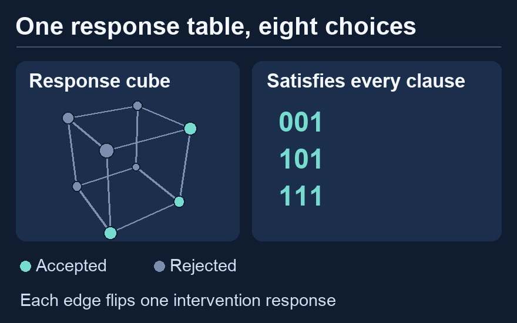

# Counterfactual satisfiability with two endogenous variables

   

Linear and basic counterfactual satisfiability are NP-complete at two endogenous variables and polynomial-time at one, with a supplied common finite domain. An XP algorithm parameterized by endogenous-variable count alone exists exactly if P = NP.

[Read the paper](paper/manuscript.pdf) · [LaTeX source](paper/manuscript.tex) · [Original question](https://raw.githubusercontent.com/mlresearch/v306/main/assets/ganian26a/ganian26a.pdf#page=9) · [Version DOI](https://doi.org/10.5281/zenodo.24572845)

## Explore the proof in 3D

The worked example has three intervention values for X. Each cube vertex selects a truth value for Y = 1 at each intervention, and each edge changes one response. The conjunction of the three displayed clauses accepts 001, 101 and 111.

[Download the offline explorer](https://raw.githubusercontent.com/DannyExperiments/two-variable-counterfactual-satisfiability/v1.0.0/visualization/response-cube-explorer.zip) · [Explorer source](visualization/index.html) · [Worked example](proof/worked-response-cube.md) · [GIF rendering source](visualization/render.py)

## Why the proof works

A single response table for Y stores a full Boolean assignment across different values of the intervention on X. Ask for one cross-world Boolean event to have probability one. An accepting exogenous draw recovers a satisfying assignment, and a satisfying assignment defines a deterministic model.

Sparse mixtures of deterministic tables give polynomial certificates for two variables. With one variable, the only unknown distribution is over its observational value, so a linear program suffices. The source requires a set of weak comparisons. Boolean operations within each event encode the clauses. [Primary sources and earlier results](audits/public_safe_reports/LITERATURE.md)

## Reproduce the checks

    python3 -I scripts/verify_repository.py
    python3 -I verification/src/replay.py

[Recorded replay](verification/results/replay.txt) · [Scope](CLAIM_SCOPE_AND_LIMITATIONS.md) · [Reproducibility](REPRODUCIBILITY.md) · [Research disclosure](AI_DISCLOSURE.md)

## Cite

DannyExperiments. *Counterfactual satisfiability with two endogenous variables*. Version 1.0.0, 27 November 2026. [Version DOI](https://doi.org/10.5281/zenodo.24572845).

## Lean verification

For every Boolean formula over intervention indices and two distinct designated outcomes, satisfiability is equivalent to the existence of a positive-total finite integer-weighted mixture of response tables making the translated event have full mass. Deterministic tables suffice in the forward direction. General finite exogenous probabilities, polynomial bit lengths and membership remain in the paper. [Source and replay](formalization/README.md)
